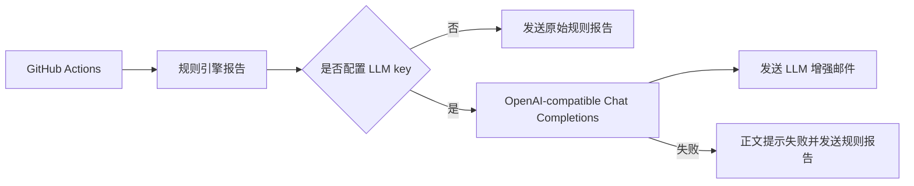

# LLM 投研助理配置指南

## 定位

LLM 投研助理是邮件发送前的可选增强层。规则引擎先生成日报或周报，LLM 根据行情、技术指标、规则、组合风险和新闻链接的证据包，追加研究推断、反向证据、不确定性与下一项核验。原始行情和规则正文保持原文。LLM 不负责抓行情，不负责改评分，不负责创造买卖结论，也不构成投资建议或交易指令。

## 最简 DeepSeek 配置

如果只想用 DeepSeek，在 GitHub `Settings` -> `Secrets and variables` -> `Actions` -> `Secrets` 中新增：

| Name | Secret 填什么 |
|---|---|
| `DEEPSEEK_API_KEY` | DeepSeek API key |

系统会自动使用 `https://api.deepseek.com` 和 `deepseek-flash`。如果要换 DeepSeek 模型，可以额外配置 `DEEPSEEK_MODEL`。

## 火山方舟配置

如果 API key 来自火山方舟，应使用 Ark 专用字段，不要把火山方舟 key 填到 `DEEPSEEK_API_KEY`。在 GitHub Secrets 中新增：

| Name | Secret 填什么 |
|---|---|
| `ARK_API_KEY` | 火山方舟 API key |
| `ARK_MODEL` | 火山方舟 model 或接入点 ID |

默认 base URL 是 `https://ark.cn-beijing.volces.com/api/v3`。如果你使用其他 region 或网关，可额外配置 `ARK_BASE_URL`。`ARK_MODEL` 必须显式填写，因为火山方舟的 `model` 可能是接入点 ID，也可能是具体模型名，项目不能替用户猜。

## 通用 OpenAI-compatible 配置

如果使用硅基流动、阿里百炼、OpenRouter、Moonshot 或其他兼容 OpenAI chat completions 的平台，配置：

| Name | 填什么 |
|---|---|
| `LLM_API_KEY` | 服务商 API key |
| `LLM_BASE_URL` | 服务商 base URL |
| `LLM_MODEL` | 模型名 |

项目也兼容常见命名：`OPENAI_API_KEY`、`OPENAI_BASE_URL`、`OPENAI_MODEL`。这里的 `OPENAI_API_KEY` 是 OpenAI-compatible 变量名，不代表只能填 OpenAI 官方 key；能否使用取决于对应 `base_url` 是否指向正确服务商。

## 失败策略

未配置 LLM key 时，系统跳过增强，继续发送规则报告。已配置 LLM key 时，如果鉴权失败、模型不可用、接口返回格式异常或网络失败，邮件会在正文顶部写明 `LLM 增强失败，已发送规则版报告` 和具体错误原因，然后继续发送规则报告。这个设计保留可审计错误提示，同时避免可选改写服务阻断核心日报或周报送达。

系统使用 `stream=true` 的 Chat Completions SSE 响应，持续接收模型增量文本并在 `[DONE]` 后拼接完整 Markdown。解析器遵循 SSE 的事件边界：会合并同一事件的多行 `data:` 字段，并兼容响应首行的 UTF-8 BOM；这两种协议细节不会错误触发规则版回退。连接最多等待 10 秒，流读取默认允许相邻数据块间隔 30 秒，可通过 `LLM_TIMEOUT_SECONDS` 调整；因此完整报告可以超过 30 秒生成，只要流没有中断。单次分析默认最多生成 `16384` tokens，可用 `LLM_MAX_TOKENS` 调整，且该值必须是正整数。连接、首次响应或 SSE 消费阶段发生读取超时时，系统等待 1 秒后重新发起一次完整请求；第二次仍超时才保留失败原因并发送规则报告，避免把部分生成内容误当作完整投资复盘。鉴权失败、模型不可用、HTTP 非成功状态和响应格式错误不会重试，会直接进入邮件的规则报告回退路径。非法 JSON 会在失败提示中给出 SSE 事件序号和 JSON 行列位置，但不会回显原始模型输出，避免错误信息泄露报告内容。

## DeepSeek 思考模式

DeepSeek 官方新模型的 API 名称为 `deepseek-flash`，对应 DeepSeek-V4.1-Flash；官方表格中的 `(1)` 是脚注，不属于模型名。证据分析使用 `thinking={"type":"enabled"}` 和 `reasoning_effort="high"`，默认输出预算 16384 tokens（包含思考消耗），只使用最终 `content`，不把 `reasoning_content` 写入邮件。`https://api.deepseek.com` 与 `/v1` 均可识别。旧 JSON 缺少 `data.evidence` 时保留旧改写兼容路径并关闭思考。

## 分析和校验

新版模型返回严格 JSON，每只持仓恰好一项，含判断、反向证据、不确定性、下一项核验与本票证据 ID，并强制提供六维 dimensions 和逐原帖 opinion_reviews。未覆盖维度、遗漏博主原帖、未知引用或无来源数字会拒绝进入分析正文。程序验证字段、覆盖范围、引用存在性和数字来源；截断响应或校验失败不能进入正式正文。没有新的财务数据、新闻全文或历史对照时，不能从模型知识补造最新事实或组合变化。

原始报告先显示常规收盘价、币种、行情时间与来源，再显示规则与风险。模型分析作为独立区块追加；图片使用本次缓存日线，不再另抓行情。引用有效只能说明输入中存在此来源，不能证明模型解释或搜索摘要本身正确。

参考：[DeepSeek 模型说明](https://api-docs.deepseek.com/quick_start/pricing/)、[思考模式](https://api-docs.deepseek.com/guides/thinking_mode/)、[结构化输出与校验](https://docs.langchain.com/oss/python/langchain/structured-output)。项目保留现有 Python 编排，不因加入分析而增加框架依赖。

## Codex 边界

GitHub Actions runner 没有你的本机 Codex 登录态，也不会自动拥有 Codex 桌面或 Codex CLI 的会话。要在云端定时任务里稳定运行，应该使用显式 API key。后续如果要做交互式问答，需要增加独立的消息入口、鉴权和回调服务，本指南只覆盖定时邮件增强。
